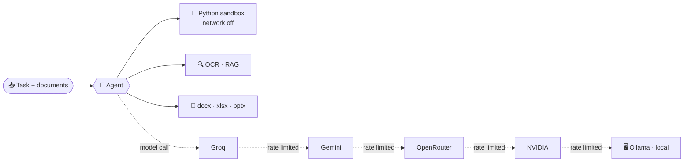
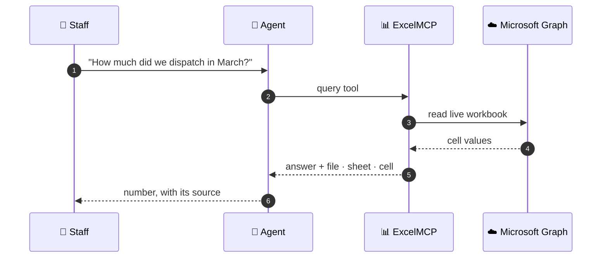
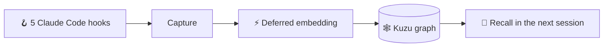
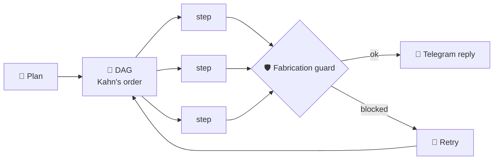

<div align="center">


<br>


<a href="https://www.linkedin.com/in/karunya-muddana/"></a>
<a href="mailto:karunya.muddana@outlook.com"></a>

</div>

<br>

> [!NOTE]
> **New account, same builder.** My previous GitHub account was suspended, so this profile starts from zero repositories.
> Everything below is real and already built. The code is being pushed back here one project at a time. **New projects coming soon.**

<br>

## 👋 Hey, I'm K

I'm a second-year CS (AI & ML) student who's been freelancing since 2024. I build AI systems for people who use them every day, not for demos.

My first real client was a chemical manufacturer in Hyderabad. Their staff wanted answers out of a pile of Excel files, so I built them an assistant that answers in plain English and **points to the exact cell behind every number**. They used it every working day until they moved to an ERP. That project taught me how I like to build:

|  | What I care about | Where it shows up |
|:--:|---|---|
| 🎯 | **Every answer carries its source.** If the model can't point to where a number came from, it shouldn't say it. | ExcelMCP cites file · sheet · cell |
| 🔁 | **A run should never die on a rate limit.** Providers fail; the agent shouldn't. | Native's 5-provider fallback chain |
| 🧪 | **Test before you trust.** Synthetic data with ground truth, not vibes. | 21-workbook stress test for ExcelMCP |
| 🛡️ | **Agents get guardrails, not blind trust.** | Smith's zero-trust runtime + fabrication guard |

<br>

## 🛠️ Things I've built

> [!TIP]
> Click any project to open how it works.

<details>
<summary><b>🧭 Native</b> · self-hosted AI agent workbench · <i>Smart India Hackathon 2026</i> · <code>v1.0.0</code></summary>

<br>

Built for **SIH problem statement 26117**, set by Mangalore Refinery and Petrochemicals (MRPL). You give it documents and a task, and it does the work end to end: reads PDFs and scans, runs Python, and hands back real Office files.

- 🐳 Code runs inside a **Docker sandbox with networking disabled at the kernel level**
- 🔍 OCR with **PP-OCRv4**, local embeddings, document readers
- 📄 Writes finished **`.docx` · `.xlsx` · `.pptx`** deliverables
- 📜 The output is the **full run trace** (every tool call, its arguments and timing), not a vague summary
- 🔁 Each model role is an ordered **fallback chain**. When one provider rate-limits, the next takes over, ending at a local model



`Python` `LangGraph` `FastAPI` `Docker` `PP-OCRv4` `RAG` `Ollama`

</details>

<details>
<summary><b>📊 ExcelMCP</b> · live Excel for AI agents · <i>MCP server, 11 tools</i></summary>

<br>

The engine behind the manufacturer's assistant. It connects any MCP-compatible agent to **live OneDrive workbooks through Microsoft Graph** and returns every value with the file, sheet and cell it came from.

- 🧮 **Scoring-based header detection** (fill, text ratio, uniqueness, contrast) for messy real-world sheets
- 🗺️ Handles **multiple tables on one sheet** with region scoping
- 📉 Cut the workspace-graph payload from **~188k to ~35k characters** with a summary/detail split
- 🧪 Stress-tested on **21 synthetic workbooks with ground-truth answers**
- 🔧 Fixed protocol bugs that real clients hit, such as stray `print()` calls corrupting JSON-RPC on stdout



`Python` `FastMCP` `Microsoft Graph` `FastEmbed` `Pandas`

</details>

<details>
<summary><b>🧠 engraph</b> · long-term memory for Claude Code · <i>published on PyPI</i></summary>

<br>

AI coding assistants forget everything when a session ends. engraph gives Claude Code a **graph memory that lasts between sessions**, captured automatically through hooks.

- 🪝 **Five Claude Code hooks** capture memory as you work. Nothing to remember to save
- 🕸️ Stored in a **Kuzu graph database** with semantic embeddings
- ⚡ **Deferred embedding** cut a 50-second cold start (torch loading on every hook) down to near-instant



```bash
pip install engraph
```

`Python` `Kuzu` `FastMCP` `sentence-transformers`

</details>

<details>
<summary><b>🛡️ Smith</b> · zero-trust agent runtime · <i>runs in production as a Telegram bot</i></summary>

<br>

The operational agent for my manufacturing client. Instead of letting a model improvise, Smith plans the work as a **DAG** and runs it with guardrails.

- 📐 Topological execution with **Kahn's algorithm** and cycle detection
- 🔀 Conditional edges and **parallel fan-out** with `asyncio`
- 🔁 Retry logic, plus a **fabrication guard** that blocks made-up results
- 🤖 Deployed on a VPS as a **Telegram bot**



`Python` `asyncio` `Telegram Bot API`

</details>

<details>
<summary><b>⚖️ Tareekh</b> · case memory for litigation lawyers · <i>Hack with Hyderabad 3.0 · team lead</i></summary>

<br>

Lawyers juggle hundreds of cases and can't afford to forget a detail in court. Tareekh is a **memory agent that remembers every case**, so the lawyer can just ask. I led the team and built the agent and the MCP server.

`Python` `Hindsight` `MCP` `SQLite`

</details>

<details>
<summary><b>📈 Smaller builds</b></summary>

<br>

| Project | What happened |
|---|---|
| **CBSE Gazette Analyzer** | Turns the board's raw result gazettes into Excel and PDF analytics. Used by teachers at **2 schools** for **600+ students**. |
| **House price model** | Benchmarked **11 models** on one split; the tuned best prices **79%** of houses within 10% of sale price. |

</details>

<br>

## 🤝 Open source

| Project | Fix | Status |
|---|---|:--:|
| **IPython** | WebP detection and size parsing in `display.Image` | ✅ merged |
| **git-cola** | Report errors when opening a repository fails | ✅ merged |
| **icalendar** | `vUTCOffset.from_ical` misreading unsigned offsets | 🔄 in review |
| **scikit-learn** | `Bunch.copy` should return a `Bunch`, not a `dict` | 🔄 in review |

<br>

## 🧰 Tech stack

<div align="center">

<br>


</div>

| | |
|---|---|
| **🧠 AI & agents** | LLM agents · MCP (FastMCP) · LangGraph · RAG · embeddings & vector search · OCR · LLM evaluation · Ollama |
| **📊 ML** | PyTorch · scikit-learn · XGBoost · LightGBM · Pandas · NumPy |
| **⚙️ Backend** | FastAPI · Supabase · PostgreSQL · SQLite · Kuzu · Docker · Microsoft Graph |
| **🎨 Frontend** | Vanilla JS · TypeScript · three.js |
| **🏁 Competitive programming** | C++ |

<br>

## 📬 Let's build something

Open to **internships**, **freelance agent work** and **good open-source issues**.<br>
**Email gets the fastest reply:** [karunya.muddana@outlook.com](mailto:karunya.muddana@outlook.com)

<div align="center">
<br>
<sub>⭐ Follow to see the projects come back online.</sub>
</div>
